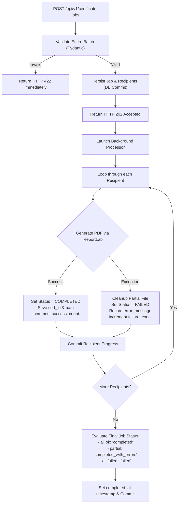

# Bulk Certificate Generation Backend API

A production-quality, high-throughput asynchronous bulk certificate generation backend built with **FastAPI**, **SQLAlchemy**, **Pydantic v2**, and **ReportLab**.

---

## Table of Contents
1. [Overview](#overview)
2. [Technology Stack & Prerequisites](#technology-stack--prerequisites)
3. [Project Architecture & Directory Structure](#project-architecture--directory-structure)
4. [Getting Started & Local Setup](#getting-started--local-setup)
   - [Virtual Environment Setup](#1-virtual-environment-setup)
   - [Dependency Installation](#2-dependency-installation)
   - [Environment Configuration](#3-environment-configuration)
   - [Running the Application](#4-running-the-application)
   - [API Documentation (Swagger / ReDoc)](#5-interactive-api-docs)
5. [Automated Testing & Test Coverage](#automated-testing--test-coverage)
6. [API Reference & Example Workflows](#api-reference--example-workflows)
   - [1. Submit Bulk Certificate Job (`POST /api/v1/certificate-jobs`)](#1-submit-bulk-certificate-job)
   - [2. Check Job Status & Progress (`GET /api/v1/certificate-jobs/{job_id}`)](#2-check-job-status--progress)
   - [3. List Jobs (`GET /api/v1/certificate-jobs`)](#3-list-jobs)
   - [4. Retrieve Recipient Results (`GET /api/v1/certificate-jobs/{job_id}/recipients`)](#4-retrieve-recipient-results)
   - [5. Download PDF Certificate (`GET /api/v1/certificates/{certificate_id}`)](#5-download-pdf-certificate)
   - [6. Health Check (`GET /health`)](#6-health-check)
7. [Failure Isolation & Partial Success Model](#failure-isolation--partial-success-model)
8. [Background Processing Architecture](#background-processing-architecture)
   - [Why FastAPI BackgroundTasks?](#why-fastapi-backgroundtasks-for-this-service)
   - [Limitations & Production Evolution Path](#limitations--production-evolution-path)
9. [Storage & Database Design](#storage--database-design)
10. [Customizing the Certificate Template](#customizing-the-certificate-template)
11. [Design Decisions, Trade-offs & Security](#design-decisions-trade-offs--security)

---

## Overview

The Bulk Certificate Generation API provides an end-to-end backend service that accepts a single bulk request containing up to 500 recipients and generates high-resolution, vector-quality, landscape-oriented PDF certificates.

### Key Capabilities:
- **Instant Non-Blocking Ingestion**: Returns `HTTP 202 Accepted` immediately upon batch validation and database persistence.
- **Asynchronous Background Processing**: Generates recipient certificates independently in the background.
- **Isolated Failure Handling**: If an individual recipient fails (e.g. malformed name, rendering error), the remaining certificates in the batch continue processing without interruption. Final status accurately reflects `completed_with_errors` or `failed`.
- **Atomic File Operations**: Partial/corrupted PDF files are automatically cleaned up upon failure.
- **Strict Validation & Security**: Hardened with Pydantic v2 schemas, strict email validation, filename sanitization, and path-traversal protection.

---

## Technology Stack & Prerequisites

- **Language**: Python 3.11+ (Tested on Python 3.12)
- **Web Framework**: [FastAPI](https://fastapi.tiangolo.com/) (High-performance ASGI framework)
- **ASGI Server**: [Uvicorn](https://www.uvicorn.org/) (Fast, lightweight ASGI server)
- **ORM / Database**: [SQLAlchemy 2.0](https://www.sqlalchemy.org/) with SQLite default (PostgreSQL ready)
- **Validation**: [Pydantic v2](https://docs.pydantic.dev/) & `email-validator`
- **PDF Generation Engine**: [ReportLab](https://www.reportlab.com/) (Direct vector graphics and typography)
- **Testing**: [Pytest](https://pytest.org/), `pytest-asyncio`, `pytest-cov`, and `httpx` / `TestClient`

---

## Project Architecture & Directory Structure

```text
bulk-certificate-generator/
│
├── app/
│   ├── __init__.py
│   ├── main.py                     # FastAPI application setup & lifecycle
│   │
│   ├── api/                        # API route layer
│   │   ├── __init__.py
│   │   └── routes/
│   │       ├── __init__.py
│   │       ├── health.py           # Health check endpoint
│   │       ├── jobs.py             # Bulk job submission, status, list, recipients
│   │       └── certificates.py     # PDF download endpoint
│   │
│   ├── core/                       # Core configuration & logging
│   │   ├── __init__.py
│   │   ├── config.py               # Pydantic Settings & environment variables
│   │   └── logging.py              # Structured application logger
│   │
│   ├── db/                         # Database layer
│   │   ├── __init__.py
│   │   ├── database.py             # SQLAlchemy engine & session factory
│   │   └── models.py               # Job & Recipient ORM models
│   │
│   ├── schemas/                    # Pydantic validation & response schemas
│   │   ├── __init__.py
│   │   ├── job.py                  # Job create, detail, summary & pagination schemas
│   │   ├── recipient.py            # Recipient create & response schemas
│   │   └── certificate.py          # Certificate metadata schema
│   │
│   ├── services/                   # Business logic layer
│   │   ├── __init__.py
│   │   ├── certificate_generator.py # ReportLab PDF canvas drawing service
│   │   └── job_processor.py        # Background batch processing & error isolation
│   │
│   └── utils/                      # Utility layer
│       ├── __init__.py
│       └── file_storage.py         # Path sanitization, safety checks & cleanup
│
├── tests/                          # Automated test suite
│   ├── __init__.py
│   ├── conftest.py                 # In-memory DB and isolated temp storage fixtures
│   ├── test_certificates.py        # PDF download & binary validation tests
│   ├── test_edge_cases.py          # Path traversal & pagination boundary tests
│   ├── test_failure_handling.py    # Partial success & error isolation tests
│   ├── test_generation.py          # PDF generation & header verification tests
│   ├── test_health.py              # Health endpoint test
│   ├── test_jobs.py                # Job creation, listing, details tests
│   ├── test_status.py              # Progress & status state machine tests
│   └── test_validation.py          # Pydantic validation & batch limit tests
│
├── storage/
│   └── certificates/               # Directory for generated PDF storage (.gitkeep)
│
├── .env.example                    # Example configuration file
├── .gitignore                      # Git ignore rules
├── requirements.txt                # Pinned production and test dependencies
└── README.md                       # Comprehensive documentation
```

---

## Getting Started & Local Setup

### 1. Virtual Environment Setup

**Linux / macOS:**
```bash
python3 -m venv .venv
source .venv/bin/activate
```

**Windows (PowerShell):**
```powershell
py -3 -m venv .venv
.\.venv\Scripts\Activate.ps1
```

### 2. Dependency Installation

```bash
pip install -r requirements.txt
```

### 3. Environment Configuration

Copy the sample `.env.example` file to `.env`:

```bash
cp .env.example .env
```

Default `.env` configuration:
```ini
APP_NAME="Bulk Certificate Generator API"
APP_VERSION="1.0.0"
API_V1_STR="/api/v1"
DEBUG=false
LOG_LEVEL="INFO"
DATABASE_URL="sqlite:///./storage/certificates.db"
STORAGE_DIR="./storage/certificates"
MAX_BATCH_SIZE=500
DEFAULT_PAGE_SIZE=20
MAX_PAGE_SIZE=100
```

### 4. Running the Application

Start the Uvicorn server:

```bash
uvicorn app.main:app --host 0.0.0.0 --port 8000 --reload
```

The server will automatically initialize SQLite database tables and ensure the certificate storage directory exists.

### 5. Interactive API Docs

Once running, access the interactive documentation:
- **Swagger UI**: [http://localhost:8000/docs](http://localhost:8000/docs)
- **ReDoc UI**: [http://localhost:8000/redoc](http://localhost:8000/redoc)
- **OpenAPI Schema**: [http://localhost:8000/openapi.json](http://localhost:8000/openapi.json)

---

## Automated Testing & Test Coverage

The test suite uses an isolated in-memory SQLite database and temporary directory fixtures so tests never touch production or local databases.

### Run All Tests:
```bash
pytest -v
```

### Run Tests with Coverage Report:
```bash
pytest --cov=app --cov-report=term-missing
```

### Test Suite Highlights:
- **Batch Validation Tests**: Empty recipient list rejection, invalid email syntax, empty names, oversized batches (> 500 recipients).
- **PDF Signature Tests**: Asserts that generated files are non-empty and start with the standard `%PDF-` header bytes.
- **Failure Isolation Tests**: Mocks recipient failures to verify that partial success transitions the job to `completed_with_errors` without impacting sibling recipients.
- **Security Tests**: Path traversal attempts in filenames and parameters are strictly sanitized.

---

## API Reference & Example Workflows

### 1. Submit Bulk Certificate Job

**Endpoint**: `POST /api/v1/certificate-jobs`  
**Status Code**: `202 Accepted`

#### Example Request (`curl`):
```bash
curl -X POST "http://localhost:8000/api/v1/certificate-jobs" \
  -H "Content-Type: application/json" \
  -d '{
    "event_name": "Python Development Bootcamp",
    "organization_name": "Tech Academy",
    "issue_date": "2026-10-09",
    "certificate_title": "Certificate of Completion",
    "recipients": [
      {
        "name": "Rahul Sharma",
        "email": "rahul@example.com"
      },
      {
        "name": "Priya Verma",
        "email": "priya@example.com"
      }
    ]
  }'
```

#### Example Response:
```json
{
  "job_id": "57375a83-42e4-42a6-a490-22fa8f79b8c8",
  "status": "pending",
  "status_url": "/api/v1/certificate-jobs/57375a83-42e4-42a6-a490-22fa8f79b8c8",
  "total_count": 2,
  "message": "Certificate generation job accepted and queued for background processing."
}
```

---

### 2. Check Job Status & Progress

**Endpoint**: `GET /api/v1/certificate-jobs/{job_id}`  
**Status Code**: `200 OK` (or `404 Not Found`)

#### Example Request (`curl`):
```bash
curl -X GET "http://localhost:8000/api/v1/certificate-jobs/57375a83-42e4-42a6-a490-22fa8f79b8c8"
```

#### Example Response:
```json
{
  "job_id": "57375a83-42e4-42a6-a490-22fa8f79b8c8",
  "event_name": "Python Development Bootcamp",
  "organization_name": "Tech Academy",
  "issue_date": "2026-10-09",
  "certificate_title": "Certificate of Completion",
  "status": "completed",
  "total_count": 2,
  "success_count": 2,
  "failure_count": 0,
  "pending_count": 0,
  "progress_percentage": 100.0,
  "created_at": "2026-10-09T09:18:34.084581Z",
  "completed_at": "2026-10-09T09:18:34.251019Z",
  "recipients": [
    {
      "id": "8b68eefe-e372-40bd-b3f1-0baf8d259a2f",
      "job_id": "57375a83-42e4-42a6-a490-22fa8f79b8c8",
      "name": "Rahul Sharma",
      "email": "rahul@example.com",
      "status": "completed",
      "certificate_id": "CERT-5F45E25CABF1",
      "error_message": null,
      "created_at": "2026-10-09T09:18:34.091417Z",
      "generated_at": "2026-10-09T09:18:34.177569Z"
    },
    {
      "id": "017c6ad4-b25f-4a04-8775-89616a371744",
      "job_id": "57375a83-42e4-42a6-a490-22fa8f79b8c8",
      "name": "Priya Verma",
      "email": "priya@example.com",
      "status": "completed",
      "certificate_id": "CERT-CB2C3D571692",
      "error_message": null,
      "created_at": "2026-10-09T09:18:34.091417Z",
      "generated_at": "2026-10-09T09:18:34.227125Z"
    }
  ]
}
```

---

### 3. List Jobs

**Endpoint**: `GET /api/v1/certificate-jobs?limit=20&offset=0&status=completed`  
**Status Code**: `200 OK`

#### Example Request (`curl`):
```bash
curl -X GET "http://localhost:8000/api/v1/certificate-jobs?limit=10"
```

---

### 4. Retrieve Recipient Results

**Endpoint**: `GET /api/v1/certificate-jobs/{job_id}/recipients?limit=50&offset=0`  
**Status Code**: `200 OK` (or `404 Not Found`)

#### Example Request (`curl`):
```bash
curl -X GET "http://localhost:8000/api/v1/certificate-jobs/57375a83-42e4-42a6-a490-22fa8f79b8c8/recipients"
```

---

### 5. Download PDF Certificate

**Endpoint**: `GET /api/v1/certificates/{certificate_id}`  
**Status Code**: `200 OK` (`application/pdf`) or `404 Not Found`

#### Example Request (`curl`):
```bash
curl -X GET "http://localhost:8000/api/v1/certificates/CERT-5F45E25CABF1" \
  --output "certificate_Rahul_Sharma.pdf"
```

---

### 6. Health Check

**Endpoint**: `GET /health`  
**Status Code**: `200 OK`

```json
{
  "status": "healthy",
  "timestamp": "2026-10-09T09:18:18.099058Z",
  "version": "1.0.0",
  "app_name": "Bulk Certificate Generator API"
}
```

---

## Failure Isolation & Partial Success Model

When processing large batches of recipients, failures must be isolated so that one failing recipient does not abort the generation of remaining certificates:



---

## Background Processing Architecture

### Why FastAPI BackgroundTasks for this Service?
1. **Zero External Operational Overhead**: Requires no Redis, RabbitMQ, or Celery workers for local setups and technical evaluations.
2. **Deterministic & Easy to Reason About**: Background tasks run within the same Python process in a separate asynchronous thread pool.
3. **Thread-Safe Session Isolation**: Uses independent, dedicated SQLAlchemy sessions inside `process_certificate_job` instead of sharing web request sessions.

### Limitations & Production Evolution Path
| Aspect | Current In-Process `BackgroundTasks` | Distributed Production Queue (e.g. Celery / ARQ + Redis) |
|---|---|---|
| **Process Crash Resilience** | In-flight jobs may remain uncompleted if the process dies. | Tasks remain in durable broker storage with automatic retries and dead-letter queues. |
| **Horizontal Scalability** | Bound to CPU cores of single API node. | Worker nodes scale horizontally independent of web traffic. |
| **Task Concurrency Control** | Simple concurrency. | Fine-grained rate limiting, priority queues, and concurrency throttling. |

---

## Storage & Database Design

### Normalized Database Schema
```text
+---------------------------------------------------------------+
|                      certificate_jobs                         |
+---------------------------------------------------------------+
| id                  : VARCHAR(36) [PK]                        |
| event_name          : VARCHAR(255)                            |
| organization_name   : VARCHAR(255)                            |
| issue_date          : DATE                                    |
| certificate_title   : VARCHAR(255)                            |
| status              : ENUM (pending, processing, completed,   |
|                             completed_with_errors, failed)    |
| total_count         : INTEGER                                 |
| success_count       : INTEGER                                 |
| failure_count       : INTEGER                                 |
| created_at          : DATETIME(TZ)                            |
| completed_at        : DATETIME(TZ, nullable)                  |
+---------------------------------------------------------------+
                                |
                                | 1 : N (CASCADE DELETE)
                                v
+---------------------------------------------------------------+
|                    certificate_recipients                     |
+---------------------------------------------------------------+
| id                  : VARCHAR(36) [PK]                        |
| job_id              : VARCHAR(36) [FK -> certificate_jobs.id] |
| name                : VARCHAR(255)                            |
| email               : VARCHAR(255)                            |
| status              : ENUM (pending, processing, completed,   |
|                             failed)                           |
| certificate_id      : VARCHAR(64) [UNIQUE, INDEXED]           |
| certificate_path    : VARCHAR(500, nullable)                  |
| error_message       : TEXT (nullable)                         |
| created_at          : DATETIME(TZ)                            |
| generated_at        : DATETIME(TZ, nullable)                  |
+---------------------------------------------------------------+
```

### PDF File Organization on Disk
PDFs are stored in job-partitioned folders to prevent single-directory inode exhaustion:
```text
storage/certificates/
└── {job_id}/
    ├── CERT-5F45E25CABF1.pdf
    └── CERT-CB2C3D571692.pdf
```

---

## Customizing the Certificate Template

The certificate layout is implemented in [`app/services/certificate_generator.py`](app/services/certificate_generator.py).

### Layout Elements:
1. **Dimensions**: Standard landscape letter format (`792pt x 612pt`).
2. **Double Border**: Outer Deep Navy (`#0f2537`, 6pt) + Inner Gold (`#c69214`, 2pt).
3. **Corner Accents**: Geometric gold corner lines for aesthetic polish.
4. **Header & Title**: Prominent organization name, customizable certificate title.
5. **Recipient Focus**: Large bold recipient name with accent underline.
6. **Official Verification Badge**: Stylized vector verification seal with dual circles and stars.
7. **Issuance & Signature Lines**: Formatted issue date and issuing authority placeholder.
8. **Unique Verification ID**: Monospace certificate identifier at bottom.

To modify fonts, dimensions, or color palettes, adjust the corresponding constants in `CertificateGenerator`.

---

## Design Decisions, Trade-offs & Security

1. **Security & Path Traversal Prevention**:
   - Filenames are sanitized using regex (`re.sub(r'[^\w\-]', '_', name)`), strictly disallowing directory separators or dot-dot tokens.
   - Storage paths are verified to ensure they resolve within the configured `STORAGE_DIR`.
2. **Database Performance**:
   - `certificate_id` and `job_id` fields are indexed for fast lookup during downloads and status queries.
   - Progress percentage and counts are calculated dynamically from persisted records.
3. **Production Readiness**:
   - Structured logging with timestamps and log levels.
   - Clean separation of concerns between API routers, Pydantic schemas, database models, and generation services.
